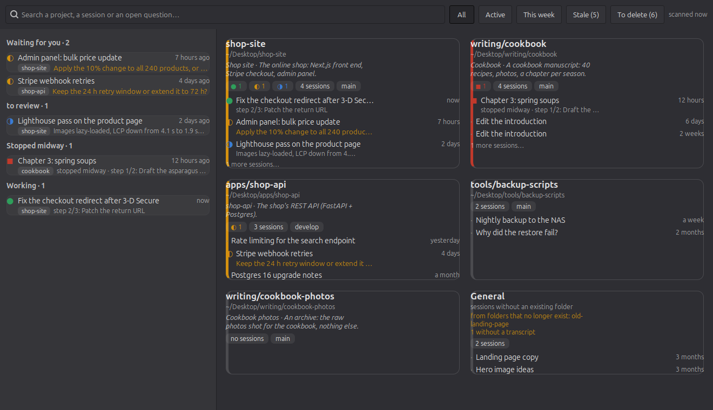
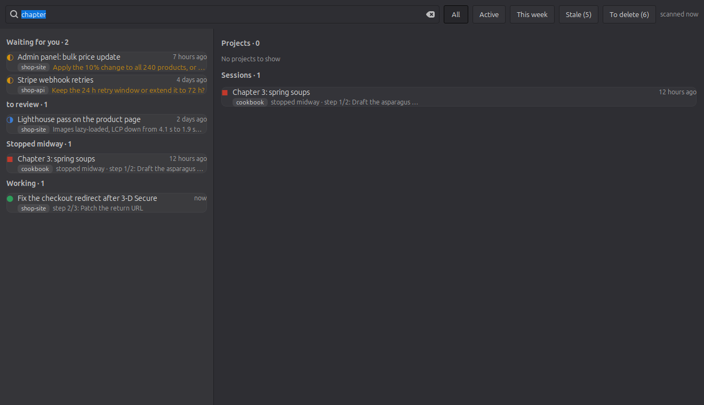
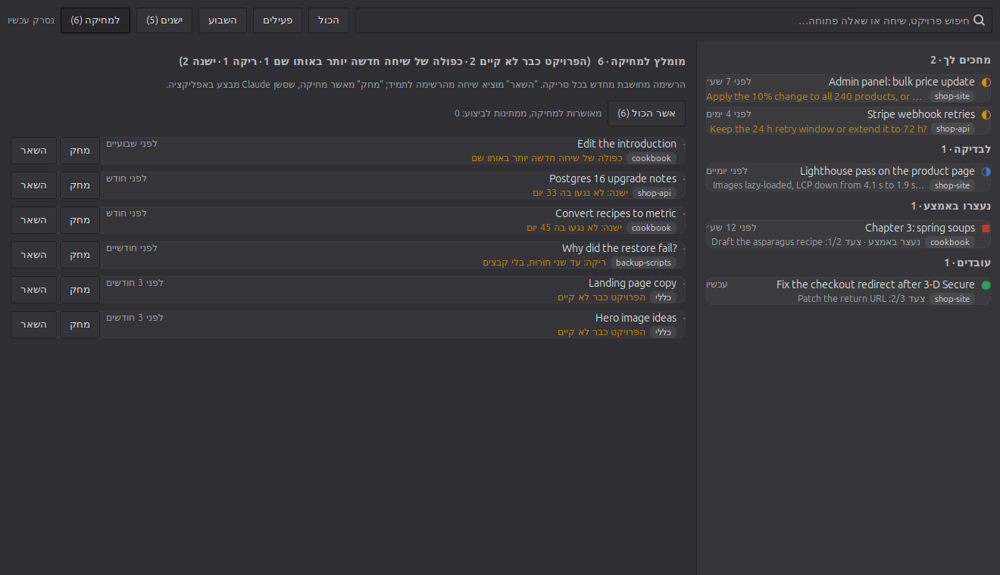

# Mishlat

**A desktop control post for your Claude Code sessions on Linux.** One window with every project
and its sessions, a panel badge for the sessions that wait for you, marks on your project folders
in the file manager, and a standing list of sessions worth deleting.

Mishlat (משלט, Hebrew for *control post*) reads what the Claude desktop app and Claude Code already
keep on your disk. It never writes into their files and never sends anything anywhere.



## What it does

- **Projects, not folders.** A session belongs to the project it *worked in*: the files it wrote
  and read, not the folder it was opened in. A session started in `~/x` that built `~/apps/y` is a
  `y` session. Moved folders are followed; folders that no longer exist go under one **General**
  card. You can assign a session by hand.
- **What needs you, across projects.** The left column lists sessions that *wait for an answer*,
  are *ready for review*, were *stopped midway*, or *work right now*, with the open question or
  the current task-list step on the row.
- **A panel icon with a badge** (Cinnamon's XApp or any AppIndicator host) and a notification when
  a session starts to wait for you.
- **Marks in Nemo and Nautilus**: an emblem on a folder with a waiting or working session, a
  "Claude" column (sessions · ◐ waiting · ● working; parent folders sum their children), and two
  right-click items: *Claude sessions of this folder…* and *New Claude session here*.
- **A cleanup list.** At every scan, sessions worth deleting get a reason: the project folder is
  gone, the transcript was deleted, a newer session has the same title, empty (two turns, nothing
  written, older than a week), or untouched for 30 days. Never the newest session of a folder,
  never a starred one, never one that waits for you. *Keep* hides a session for good; *Delete*
  approves it. The deletion itself is done by the app, through a Claude session (see below).
- **Search** over project names, paths, session titles, open questions, steps and first prompts.
- **Click a row to open the session** in the Claude app; right-click to resume it in a terminal,
  open its folder, copy its id, assign it, or hide it.
- **A purpose line per folder** from its `README.md`, so an archive does not look like a live
  project; or write your own from the card's menu.
- English or Hebrew UI (right-to-left), Ctrl+L to switch; Ctrl+= / Ctrl+- for the text size.

| Search | Cleanup list (Hebrew UI) |
|---|---|
|  |  |

## Install

Requirements: Linux with GTK 3 and PyGObject (any current desktop has them), the Claude desktop
app with Claude Code sessions, Python 3.10+. For the panel icon: Cinnamon (XApp) or an
AppIndicator host (GNOME with the AppIndicator extension, KDE, XFCE, MATE). For folder marks:
Nemo (`nemo-python`) or Nautilus (`nautilus-python`).

```bash
git clone https://github.com/yosefco3/mishlat.git
cd mishlat && ./install.sh
```

User scope, no sudo. It installs the package to `~/.local/share/mishlat/`, the launcher to
`~/.local/bin/mishlat`, a menu entry, an autostart entry for the tray, the file-manager extension,
and the **Super+Shift+C** hotkey (Cinnamon and GNOME; other desktops get an instruction to bind
`mishlat --toggle` themselves). Run `./install.sh` again to upgrade. `./uninstall.sh` removes it
(`--purge` also deletes `~/.cache/mishlat` and `~/.config/mishlat`).

Try it on made-up data first, without touching your own:

```bash
export MISHLAT_HOME=$(python3 scripts/demo_home.py) MISHLAT_PROC_ROOT=$MISHLAT_HOME/_proc
python3 -m mishlat
```

## Use

| What | How |
|---|---|
| Show or hide the window | Super+Shift+C, the menu entry, or `mishlat` |
| Open a session | click its row; right-click for more |
| One folder only | right-click the folder in the file manager ▸ *Claude sessions of this folder…* |
| Scan now | Ctrl+R, the ⟳ button, or the tray menu |
| Search | type (Ctrl+F); Esc clears, a second Esc hides the window |
| Sessions worth deleting | the *To delete (N)* chip; *Keep* or *Delete* per row, *Approve all* |
| Run the approved deletions | in any Claude session: *"delete the sessions I approved in Mishlat"* |
| Move a session to another project | right-click ▸ *Assign to a project…* |
| Describe a folder | right-click the card ▸ *Describe the folder…* (optionally written as its README) |
| Language, text size | Ctrl+L; Ctrl+= / Ctrl+- / Ctrl+0 |
| Without the GUI | `mishlat scan` (summary), `mishlat scan --json` (the whole index), `mishlat cleanup` |

**Running the deletions.** Mishlat only approves: the ids wait in
`~/.config/mishlat/delete-requests.json`. Tell any Claude Code session in the desktop app to delete
them; it runs `mishlat cleanup --json` and deletes each session through the app's own session
tools, which confirm every deletion. The next scan drops the deleted sessions from the list.

## How it decides

**Session states.** *working*: a live Claude Code process and a transcript write in the last
90 s · *open*: a live process, quiet · *waiting*: the app's post-turn summary for the last turn
says the session is blocked on you · *review*: that summary says the turn ended with something
to review · *stopped*: the user interrupted a turn with a task-list step still in progress ·
*idle*: everything else.

**The project of a session.** First the folder it ran in, with moved folders followed through
their transcripts. Then the work: 3 × files written + files read, per project; the top project
wins when it has 15 points or more and more than twice the start folder's. A manual assignment
wins over both.

**Project cards** show the folder's branch and whether it is dirty, counts per state, the newest
sessions, and a purpose line from `README.md`.

## What it reads, what it writes

Reads, never writes: the Claude desktop app's session records
(`~/.config/Claude/claude-code-sessions/`), Claude Code's transcripts (`~/.claude/projects/`, by
session id, read incrementally), the live process registry (`~/.claude/sessions/` with `/proc`),
the folders under your roots (3 levels, default `~/Desktop`), and `.git/HEAD` plus `git status` of
project repositories.

Writes only its own files, private (mode 0600): `~/.cache/mishlat/index.json` (the index every
part reads) and `transcripts.json` (the incremental-read cache); in `~/.config/mishlat/`:
`settings.json`, `assignments.json`, `dismissed.json`, `keep.json`, `delete-requests.json`,
`descriptions.json`, `aliases.json`. The one exception is a `README.md` written into a project
folder when you ask for it from the card's menu, and only if the folder has none.

`settings.json`:

```json
{"roots": ["~/Desktop", "~/work"], "old_days": 30, "font_px": 15, "lang": "en"}
```

## The plugin

The `plugin/` folder is a Claude Code plugin with the same scanner (pure Python, no GUI) and three
slash commands: `/projects`, `/needs-me`, `/cleanup`. It runs inside Claude Code on Linux and
macOS, with no desktop integration. See `plugin/README.md`.

## Limits, honestly

- Linux only (GTK 3, Nemo/Nautilus). The plugin's scanner also runs on macOS.
- Everything rests on files the Claude app keeps for itself and does not document. An app update
  can change them; the scanner then reports what it could not read instead of showing nothing.
- "Working" is inferred from transcript writes; a long silent tool call shows as "open".
- Nautilus support is written against nautilus-python 4 and has not been run by the author.
- Cinnamon's XApp tray works out of the box; on GNOME you need an AppIndicator extension.

## Develop

```bash
python3 -m pytest -q      # tests; a fake home, no display needed
make check                # tests + TEST_GRAPH.md + the code graph
```

Architecture and rules: `APP_OVERVIEW.md`. Specs with their decisions: `features-prompts/`.
How to contribute: `CONTRIBUTING.md`.

## License

MIT. © 2026 Yosef Cohen.

---

<div dir="rtl">

**בעברית.** משלט נולד מבעיה פשוטה: מאה ושבעים שיחות Claude בסרגל אחד, בלי לדעת איזו שייכת לאיזה
פרויקט ומי מחכה לי. החלון מראה כל פרויקט ככרטיס, מי מחכה לך בעמודה אחת, סימונים על התיקיות
במנהל הקבצים, ורשימה מתמדת של שיחות שכדאי למחוק. הממשק בעברית כשה-locale עברי, או עם Ctrl+L.

</div>
